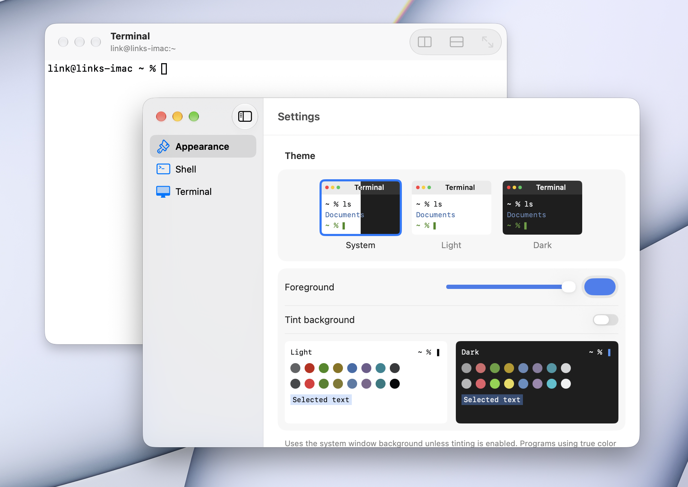

# Terminal

A native macOS terminal emulator built with SwiftUI and [SwiftTerm](https://github.com/migueldeicaza/SwiftTerm).



## Features

- Multiple panes with split, maximize, and native tab support.
- SwiftTerm-powered emulation with Metal rendering, including ligatures, 24-bit color, sixel, iTerm2, and Kitty graphics.
- Per-pane working directory and process tracking for title, subtitle, and close-confirmation; new splits and tabs inherit the current directory.
- Clickable hyperlinks (OSC 8, `Cmd`-hover/`Cmd`-click, toggle in Terminal settings) with implicit URL fallback.
- Semantic prompts (OSC 133) — **Previous Prompt** (`Opt+Cmd+Up`), **Next Prompt** (`Opt+Cmd+Down`), and **Clear to Start** (`Ctrl+Cmd+K`) backed by SwiftTerm's scroll-to-prompt.
- Shell integration — `TERM_PROGRAM`, `COLORTERM`, and `TERMINAL_SHELL_INTEGRATION` environment for new sessions plus bundled `zsh`/`bash` OSC 7/133 scripts.
- Bidirectional text, Kitty keyboard protocol, and mouse-reporting support via SwiftTerm.
- Appearance controls — system/light/dark, foreground/background tints, font chooser, and cursor style.
- Window and tab title customization, default geometry, and shell configuration.
- Find interface backed by SwiftTerm's search engine.
- Auto-updates via [Sparkle](https://sparkle-project.org/).

## Requirements

- macOS 26.0 (Tahoe) or later
- Xcode 26.0 or later with Swift 6.0

## Building

Open the project in Xcode:

```sh
open Terminal.xcodeproj
```

Select the **Terminal** scheme and run ( <kbd>Cmd+R</kbd> ). Dependencies resolve via Swift Package Manager on first build:

- [SwiftTerm](https://github.com/migueldeicaza/SwiftTerm) — terminal emulation (1.99.x)
- [Sparkle](https://github.com/sparkle-project/Sparkle) — app updates (2.10.x)

### Secrets

The project uses a base configuration file for local secrets, matching the pattern in [`Sift`](../Sift):

```sh
cp Secrets.xcconfig.example Secrets.xcconfig
# Edit DEVELOPMENT_TEAM with your Apple Developer Team ID
```

`Secrets.xcconfig` is gitignored. CI can create an empty one (`touch Secrets.xcconfig`) and pass `CODE_SIGNING_ALLOWED=NO` for unsigned builds, as in the Quack `ci.yml` workflow.

`DEVELOPMENT_TEAM` is read from `Secrets.xcconfig` via `Terminal.xcodeproj/project.xcproj` configurations:

```json
"configurations": [
  { "name": "Debug", "file": "Secrets.xcconfig" },
  { "name": "Release", "file": "Secrets.xcconfig" }
]
```

## Running Tests

From Xcode: <kbd>Cmd+U</kbd>

From the command line:

```sh
xcodebuild test -project Terminal.xcodeproj -scheme Terminal
```

## Configuration

All settings live in the in-app **Settings** window (`Cmd+,`):

- **General** — appearance (system/light/dark), tints, font, window size, cursor, and Sparkle updates (automatic checks + manual "Check for Updates…").
- **Shell** — default login shell or custom command, exit behavior, and close confirmation.
- **Terminal** — `TERM` declaration, input options, bell, scrollback, hyperlinks (`Enable OSC 8 hyperlinks`), and shell integration (`Enable shell integration`).

Settings are persisted to `UserDefaults` and exposed via `@Observable` `TerminalSettings` (`Terminal/Models/TerminalSettings.swift:147`). The app also exposes **Check for Updates…** in the app menu (`Cmd` check after `.appInfo`, `Terminal/TerminalApp.swift:37`). Hyperlink highlighting uses SwiftTerm's `linkReporting=.implicit` and `linkHighlightMode=.hoverWithModifier` (`Terminal/Views/TerminalBridge.swift:272`); shell integration adds `TERM_PROGRAM`/`TERMINAL_SHELL_INTEGRATION` via `Terminal/Services/ShellIntegration.swift:29` (`zsh`/`bash` OSC 7/133 scripts for manual sourcing).

## Updates

Auto-updates are provided by Sparkle 2:

- **Feed:** `https://subpop.github.io/Terminal/appcast.xml` (`Terminal-Info.plist:5`, `SUFeedURL`/`SUPublicEDKey`)
- **Controller:** `@Observable` `SoftwareUpdater` (`Terminal/Services/SoftwareUpdater.swift:1`) wrapping `SPUStandardUpdaterController`. Guards `XCODE_RUNNING_FOR_PREVIEWS` and `XCTestConfigurationFilePath` so previews and tests don't initialize Sparkle (`SoftwareUpdater.swift:10`).
- **UI:** `General → Updates` toggle (`automaticallyChecksForUpdates`) and menu item `Check for Updates…` disabled until `canCheckForUpdates` (`Terminal/Views/SettingsView.swift:105`, `Terminal/TerminalApp.swift:20`). Hardened runtime is enabled (`ENABLE_HARDENED_RUNTIME=YES`, `Terminal.xcodeproj/project.xcproj:68`) and the sandbox is off for Developer-ID distribution.

`SUPublicEDKey` in `Terminal-Info.plist` must be replaced with the Ed25519 public key from `generate_keys` (Sparkle). Keep the private key out of the repo; `generate_appcast` signs the DMG enclosure with it.

## Releasing

The release pipeline consists of `scripts/prepare-dmg.sh`, `scripts/publish-update.sh`, `scripts/release.sh`, and the Sparkle feed at `docs/appcast.xml`:

### 1. Bump version

Update in `Terminal.xcodeproj/project.xcproj`:

```json
"MARKETING_VERSION": "1.1",
"CURRENT_PROJECT_VERSION": "2",
```

Add a `CHANGELOG.md` entry with header `## 1.1 (2) (YYYY-MM-DD)` — `publish-update.sh` extracts the section with `awk` on that header.

### 2. Archive

In Xcode, **Product → Archive** with a Developer-ID Application identity (`DEVELOPMENT_TEAM` from `Secrets.xcconfig`), then **Distribute → Copy App** or export to `builds/<Name>/Terminal.app`. The `builds/` directory is gitignored.

### 3. Prepare a notarized DMG

Requires `create-dmg` (`/opt/local/bin/create-dmg`) and a `notarytool` keychain profile `notarytool-signing-profile` (see `xcrun notarytool store-credentials`):

```sh
export DEVELOPER_ID="ABCDEF1234"  # SHA-1 of Developer ID Application certificate
./scripts/prepare-dmg.sh          # pick a build in builds/, codesign + notarize + staple
```

This produces `builds/Terminal-<version>/Terminal-<version>.dmg` and prints the path as its last line (`scripts/prepare-dmg.sh:95`).

### 4. Publish

Requires `gh` CLI (`gh auth login`) and `pandoc` for changelog HTML, plus `generate_appcast` from Sparkle's toolchain:

```sh
./scripts/publish-update.sh /path/to/Terminal-1.1.dmg
# or
./scripts/release.sh  # runs prepare + publish
```

`publish-update.sh` (`scripts/publish-update.sh:38`):

1. `generate_appcast --link https://subpop.github.io/Terminal` in the DMG's directory.
2. Extracts `VERSION`/`BUILD` from the partial appcast and changelog from `CHANGELOG.md`.
3. Fetches existing `docs/appcast.xml` from `https://raw.githubusercontent.com/subpop/Terminal/main/docs/appcast.xml`, aborts on duplicate `BUILD`.
4. Merges the new `<item>` on top, injects `<description><![CDATA[ … ]]></description>` from pandoc HTML, and rewrites the enclosure URL to `https://github.com/subpop/Terminal/releases/download/v<VERSION>/Terminal-<VERSION>.dmg`.
5. After confirmation, `gh release create/upload` to `subpop/Terminal` and commits `docs/appcast.xml` + `git push`.

`docs/appcast.xml` (`docs/appcast.xml:1`) is deployed via GitHub Pages. The included workflow (`.github/workflows/pages.yaml:1`) publishes `docs/` on pushes to `main` (paths `docs/**`). Ensure the repo's **Settings → Pages → Source** is set to "GitHub Actions" (or "Deploy from branch `main` / `docs`").

### Appcast entries

Each `<item>` contains `sparkle:version` (build), `sparkle:shortVersionString` (marketing), `sparkle:minimumSystemVersion`, and a signed `enclosure` with `sparkle:edSignature` validated against `SUPublicEDKey`.

## Performance

PTY read throughput measured with [vtebench](https://github.com/alacritty/vtebench) (`cargo run --release -- --dat results.dat`, 10s per benchmark, default 1 MiB sample). Values are median time per sample in milliseconds — lower is better.

| Benchmark | Terminal | Apple Terminal | Ghostty |
|---|---:|---:|---:|
| dense_cells | 6.0 ms | 27.0 ms | 6.0 ms |
| medium_cells | 5.0 ms | 50.0 ms | 4.0 ms |
| scrolling | 11.0 ms | 211.0 ms | 17.0 ms |
| scrolling_bottom_region | 13.0 ms | 177.5 ms | 14.0 ms |
| scrolling_bottom_small_region | 13.0 ms | 810.0 ms | 14.0 ms |
| scrolling_fullscreen | 15.0 ms | 999.0 ms | 21.0 ms |
| scrolling_top_region | 15.0 ms | 891.5 ms | 14.0 ms |
| scrolling_top_small_region | 13.0 ms | 328.0 ms | 14.0 ms |
| sync_medium_cells | 6.0 ms | 7395.5 ms | 5.0 ms |
| unicode | 4.0 ms | 82.0 ms | 2.0 ms |

Source files generated 2026-11-20, medians over 352–3628 samples per benchmark; Apple Terminal produced fewer samples on slow benchmarks due to the 10s timeout). vtebench stresses only PTY read speed and does not measure frame rate or input latency — see its [disclaimer](https://github.com/alacritty/vtebench#disclaimer).

## Project layout

```
Terminal.xcodeproj/project.xcproj   # structured Xcode project (replaces pbxproj)
Terminal/Terminal-Info.plist        # SUFeedURL + SUPublicEDKey
Terminal/                            # app target sources
  TerminalApp.swift                 # App entry, updater wiring, menu commands (Find, prompt nav)
  ContentView.swift
  Models/                           # TerminalSettings, WorkspaceStore/WorkspaceTabs, Pane/Node types
  Services/SoftwareUpdater.swift    # Sparkle wrapper
  Services/ShellIntegration.swift   # TERM_PROGRAM env + zsh/bash OSC 7/133 scripts
  Views/                            # SettingsView, TerminalBridge (Metal, links, BiDi), workspace chrome
TerminalTests/                      # hosted unit tests (Themes, WorkspaceStore, splits, shell integration)
scripts/                            # prepare-dmg.sh, publish-update.sh, release.sh
docs/appcast.xml                    # Sparkle feed, deployed to Pages
CHANGELOG.md                        # version (build) headers consumed by publish-update.sh
```

## License

Licensed under the Apache License, Version 2.0.
